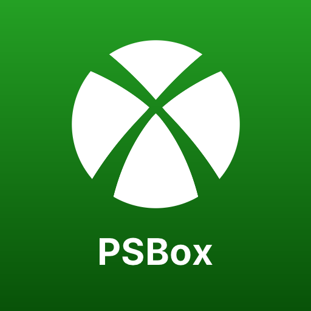

<p align="center">
  
</p>

<h1 align="center">PSBox Cloud Gaming</h1>
<p align="center"><em>Xbox Cloud Gaming, running natively on PlayStation 5.</em></p>

<p align="center">
  <a href="https://github.com/RafaelNGP/xbox-cloud-gaming-ps5/releases/latest"></a>
  <a href="#installation"></a>
  
  <a href="LICENSE"></a>
  <a href="https://github.com/RafaelNGP/xbox-cloud-gaming-ps5/issues/new?template=bug_report.yml"></a>
</p>

A native Xbox Cloud Gaming client for jailbroken consoles: browse the cloud
catalog and stream games at 1080p60, with the DualSense as an Xbox controller.
The **PS5** is the main target. The same app also has builds for **PS4**
(GoldHEN) and **Linux** (including the Steam Deck).

- **Sign in on your phone** with a code shown on the TV; no password on the console.
- **Game Pass and Your games** tabs, search, and free-to-play games.
- **My consoles**: play your own Xbox (Remote Play), its screen, games and apps.
- **Sharp picture**: upscaled to 4K on the GPU (AMD FSR 1 or Anime4K), with
  compression blocks smoothed.
- **DualSense**: rumble, adaptive-trigger vibration, light bar in the game's
  colour, up to four controllers.
- **In-game menu** (OPTIONS + TOUCHPAD): statistics, picture options, stream
  resolution; the PS5 keyboard for games' text fields.
- **Reconnects** by itself after a short network drop.
- Six languages.

**You need** a Microsoft account with a Game Pass plan that includes cloud
gaming (Essential, Premium or Ultimate). Since November 2026, Xbox limits cloud
play each month: 15 h with Ultimate, 10 h with Premium and 5 h with Essential.

## Installation

### PS5

Needs a homebrew-enabled PS5 that runs directory-style apps from
`/data/homebrew`, for example through ShadowMountPlus. Reported working on
firmware 13.00 and 13.60; please open an issue with your firmware and loader if
it doesn't work for you.

Install it in one of three ways:

- **RecompStore:** <https://recompstore.com/game/PPSA99810>
- **Prospero Store:** <https://prosperostore.net/app/PPSA99810/>
- **By hand:**
  1. Download `PPSA99810.zip` from the
     [latest release](https://github.com/RafaelNGP/xbox-cloud-gaming-ps5/releases/latest).
  2. Extract it and copy the `PPSA99810` folder, as a whole, to
     `/data/homebrew/` on the PS5 (for example over FTP).
  3. Wait for the loader to add the **PSBox Cloud Gaming** icon to the Home
     screen.

Then launch the app and sign in: open <https://www.microsoft.com/link> on your
phone or computer (or scan the QR code) and enter the code shown on the TV.

**Updates** install from inside the app (it asks after sign-in; also Settings >
Updates). Only a package signed with the project's key is accepted, and your
sign-in is kept. By hand: close the app and copy the new folder over the old one.

**Your data** (sign-in, settings, caches, log) lives in `/data/psbox`, outside
the app's folder, so updating or reinstalling keeps it. The sign-in is
`/data/psbox/account.json`: never share that file. To remove everything, delete
`/data/psbox` too. Controls and troubleshooting are in the `README.txt` inside
the app's folder.

### PS4

Needs a PS4 with GoldHEN.

1. Download the PS4 `.pkg` from the
   [latest release](https://github.com/RafaelNGP/xbox-cloud-gaming-ps5/releases/latest).
2. Copy it to the root of a USB drive formatted as exFAT or FAT32, and plug the
   drive into the PS4.
3. Install it from *Settings > GoldHEN > Package Installer*.

The PS4 build does not update itself yet: install the newer `.pkg` the same way.

### Linux and Steam Deck

Download the `.AppImage` from the
[latest release](https://github.com/RafaelNGP/xbox-cloud-gaming-ps5/releases/latest),
make it executable (`chmod +x`) and run it. It works in the Steam Deck's Desktop
and Game modes. Your data lives in `~/.local/share/psbox`. It does not update
itself: Settings > Updates opens the release page.

## Building

Clone with the submodules (Mbed TLS, libdatachannel, FFmpeg):

```bash
git clone --recursive https://github.com/RafaelNGP/xbox-cloud-gaming-ps5.git
cd xbox-cloud-gaming-ps5
```

You need CMake 3.20+, Ninja, Clang/LLVM, Python 3 and curl. NASM and FFmpeg are
built automatically the first time CMake runs.

**Linux** (the desktop app needs SDL3 3.2+ with its development files:
`SDL3-devel` on Fedora, `libsdl3-dev` on Debian / Ubuntu):

```bash
cmake -S . -B build-host -G Ninja -DCMAKE_BUILD_TYPE=RelWithDebInfo
ninja -C build-host
build-host/xcloud-tests                     # unit tests
build-host/psbox                            # the app (F11: fullscreen)
tools/desktop/package-appimage.sh build-host   # -> the .AppImage
```

**PS5** (uses the [PS5_Vulkan](https://github.com/mihawk-99/PS5_Vulkan)
toolchain, built at `../PS5_Vulkan` or pointed to by `PS5_VULKAN`):

```bash
cmake -S . -B build-ps5 -G Ninja -DCMAKE_TOOLCHAIN_FILE=cmake/ps5.toolchain.cmake -DCMAKE_BUILD_TYPE=Release
ninja -C build-ps5 xcloud_app
tools/ps5/link.sh build-ps5                 # -> build-ps5/eboot.bin
tools/ps5/package.sh build-ps5              # -> build-ps5/pkg/PPSA99810/
```

**PS4** (uses the OpenOrbis toolchain, fetched to `./ps4-toolchain` or pointed
to by `OO_PS4_TOOLCHAIN`):

```bash
tools/ps4/fetch-toolchain.sh
cmake -S . -B build-ps4 -G Ninja -DCMAKE_TOOLCHAIN_FILE=cmake/ps4.toolchain.cmake
ninja -C build-ps4
tools/ps4/package.sh build-ps4              # -> build-ps4/pkg/*.pkg
```

More for development:

- `build-host/xcloud-cli login`, `stream <TITLE> 30` and `ui-preview <dir>`:
  sign in, stream a title, render every screen to PNG.
- `bash tools/check-platform-boundaries.sh`: console calls stay in their
  platform backends (see `docs/multiplatform.md`).
- **120 Hz on the PS5** needs RADV built with
  `tools/ps5/patches/mesa-videoout-vrr-120hz.patch` (with PS5_Vulkan's
  `tools/build-radv.sh`); without it the output stays at 59.94 Hz.
- `tools/release.sh <X.Y.Z>` builds, signs and checks a PS5 release; it
  publishes nothing. The signing key stays with the maintainer: the app trusts
  only its public half (`src/app/updater.cpp`).

## License

GPL-3.0-or-later; see `LICENSE`. The PS5 binary statically links the PS5 app
runtime and payload SDK platform layer, which are GPL-3.0-or-later, so the
project as distributed must be too. All other components are compatible
(Mbed TLS, libdatachannel, FFmpeg under the LGPL, stb, qrcodegen, the Inter
font, Mozilla's CA bundle); `THIRD_PARTY_NOTICES.md` lists each one with its
version and license.

This is an unofficial project, not affiliated with, endorsed or sponsored by
Microsoft or Sony. Xbox, Xbox Cloud Gaming and Game Pass are trademarks of the
Microsoft group of companies; PlayStation, PS4 and PS5 are trademarks of Sony
Interactive Entertainment. Game names and artwork are loaded from Microsoft's
public catalog at runtime and are not distributed with this project.
Microsoft may change or block the services this client relies on at any time.
