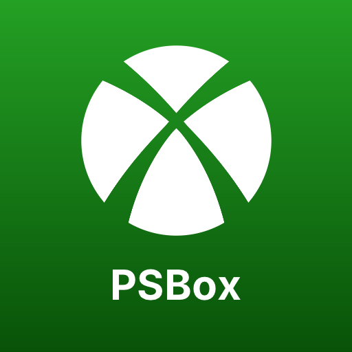

<p align="center">
  
</p>

<h1 align="center">PSBox Cloud Gaming</h1>
<p align="center"><em>Xbox Cloud Gaming, running natively on PlayStation 5.</em></p>

<p align="center">
  <a href="https://github.com/RafaelNGP/xbox-cloud-gaming-ps5/releases/latest"></a>
  <a href="#installation"></a>
  
  <a href="LICENSE"></a>
  <a href="https://github.com/RafaelNGP/xbox-cloud-gaming-ps5/issues/new?template=bug_report.yml"></a>
</p>

A native Xbox Cloud Gaming client for jailbroken PS5 consoles: browse the
cloud catalog and stream games at 1080p60, with the DualSense as an Xbox
controller.

- **Sign in on your phone** with a code shown on the TV; no password on the console.
- **Game Pass and Your games** tabs, search, and free-to-play games.
- **My consoles**: play your own Xbox (Remote Play), its screen, games and apps.
- **Sharp picture**: upscaled to 4K on the GPU (AMD FSR 1 or Anime4K), with
  compression blocks smoothed.
- **DualSense**: rumble, adaptive-trigger vibration, light bar in the game's
  colour, up to four controllers.
- **In-game menu** (OPTIONS + TOUCHPAD): statistics, picture options, stream
  resolution; the PS5 keyboard for games' text fields.
- **Reconnects** by itself after a short network drop.
- Six languages.

Requires a homebrew-enabled PS5 that can run directory-style apps (for
example through ShadowMountPlus), and a Microsoft account with a Game Pass
plan that includes cloud gaming. Since October 2025 all three do: Essential
and Premium stream at up to 1080p with a smaller catalog, Ultimate has the
largest one.

Reported working on firmware 13.00 and 13.60 with ShadowMountPlus. Other
loaders that run directory apps from `/data/homebrew` should work too;
please report your firmware and loader in an issue if it doesn't.

## Installation

No building needed: download `PPSA99810.zip` from the
[latest release](https://github.com/RafaelNGP/xbox-cloud-gaming-ps5/releases/latest).

1. Extract the zip and copy the `PPSA99810` folder, as a whole, to
   `/data/homebrew/` on the PS5 (for example over FTP).
2. Wait for the loader (e.g. ShadowMountPlus) to add the **PSBox Cloud Gaming**
   icon to the Home screen, then launch it.

   Or install it from **ProsperoStore** (the homebrew store, listed on
   [homebrew.page](https://homebrew.page)).
3. Sign in: open <https://www.microsoft.com/link> on your phone or computer
   (or scan the QR code) and enter the code shown on the TV.

New versions install from inside the app (it asks after sign-in, and
Settings > Updates): only a package signed with the project's key is
accepted, and your sign-in is kept. By hand: close the app and copy the
new folder over the old one. Since v0.9.7 the sign-in, settings, caches
and log live in `/data/psbox`, outside the app's folder: updating,
reinstalling or uninstalling the app (also from ProsperoStore) keeps
them, and the first start moves them there from older versions. The
sign-in is `/data/psbox/account.json`: never share that file. To remove
everything the app keeps, delete `/data/psbox` too. More details, controls and troubleshooting are in the
`README.txt` inside the folder.

## Building

Clone with the submodules (Mbed TLS, libdatachannel, FFmpeg):

```bash
git clone --recursive https://github.com/RafaelNGP/xbox-cloud-gaming-ps5.git
cd xbox-cloud-gaming-ps5
```

Requirements: CMake 3.20+, Ninja, Clang/LLVM (clang, clang++, llvm-ar,
llvm-ranlib), Python 3 and curl. NASM is built automatically if missing.
FFmpeg is configured and built by `tools/build-ffmpeg.sh` the first time
CMake runs.

### Desktop build (Linux)

Used to develop and check the protocol and the UI on a PC. The app is
becoming multiplatform (PS5, Linux, Windows): see `docs/multiplatform.md`.

```bash
cmake -S . -B build-host -G Ninja -DCMAKE_BUILD_TYPE=RelWithDebInfo
ninja -C build-host
build-host/xcloud-tests                       # unit tests
build-host/xcloud-cli login                   # sign in
build-host/xcloud-cli stream BALATRO 30       # stream a title for 30 s (--720p, --region=EASTUS)
build-host/xcloud-cli ui-preview /tmp/ui      # render every screen to PNG
build-host/psbox-headless                     # the app with no window or devices (Ctrl+C closes it)
bash tools/check-platform-boundaries.sh       # PS5 calls only in the PS5 backends
```

### Linux (preview)

`psbox` is the app in a window, on SDL3 (3.2 or newer, with its development
files: `SDL3-devel` on Fedora, `libsdl3-dev` on Debian / Ubuntu). It is
built with the desktop build above whenever CMake finds SDL3
(`-DXCLOUD_DESKTOP_APP=ON` to require it, `OFF` to skip it).

```bash
build-host/psbox                  # F11 or Alt+Enter: fullscreen; --fullscreen, --data-dir <dir>
SDL_VIDEO_DRIVER=offscreen SDL_AUDIO_DRIVER=dummy build-host/psbox --selftest /tmp/psbox-selftest
```

Sign-in, settings and the log live in `~/.local/share/psbox` (or
`$XCLOUD_DATA_DIR`); the fonts and certificates are copied to `assets/`
beside the executable. Controllers (DualSense, DualShock 4, Xbox, Switch...),
keyboard and mouse are supported (a preview: not checked on every pad yet); options the PC can't honour (light bar without a
DualSense, 120 Hz, the PS5's upscalers) are hidden. It doesn't update
itself: Settings > Updates opens the release page. See
`docs/multiplatform.md` (M1).

### PS5 build

The console build uses the toolchain of
[PS5_Vulkan](https://github.com/mihawk-99/PS5_Vulkan) (the PS5 payload SDK, the PS5 linker
recipe and `ps5-native-tool`). Clone and build it next to this repository, as its
README describes, so that it sits at `../PS5_Vulkan`; or set `PS5_VULKAN` to point elsewhere.

```bash
cmake -S . -B build-ps5 -G Ninja -DCMAKE_TOOLCHAIN_FILE=cmake/ps5.toolchain.cmake -DCMAKE_BUILD_TYPE=Release
ninja -C build-ps5 xcloud_app
tools/ps5/link.sh build-ps5          # -> build-ps5/eboot.bin
tools/ps5/package.sh build-ps5       # -> build-ps5/pkg/PPSA99810/
```

**120 Hz output** (Settings and each game's settings, off by default; only while a
game streams, the menus stay at 60 Hz) needs RADV with
`tools/ps5/patches/mesa-videoout-vrr-120hz.patch` (two commits): with the console's
VRR on, a 120 Hz request becomes VRR 119.88 Hz, whose idle vblank (the TV's VRR
floor, ~48 Hz) the unpatched check takes for 60 Hz and undoes; and
`wsi_videoout_set_high_refresh()` switches the open output at a stream's start and end. Apply it to PS5_Mesa at
PS5_Vulkan's pinned revision on a local branch, then
`PS5_MESA_REVISION=<that commit> tools/build-radv.sh release` in PS5_Vulkan. Without
it the option stays at 59.94 Hz (or, turned on in Settings, applies to the whole app from its next start).

A release is built, signed and checked with `tools/release.sh <X.Y.Z>`
(see the script's header); it publishes nothing. The signing key stays with
the maintainer: the app trusts only its public half (`src/app/updater.cpp`).

## License

GPL-3.0-or-later; see `LICENSE`. The PS5 binary statically links the PS5 app
runtime and payload SDK platform layer, which are GPL-3.0-or-later, so the
project as distributed must be too. All other components are compatible
(Mbed TLS, libdatachannel, FFmpeg under the LGPL, stb, qrcodegen, the Inter
font, Mozilla's CA bundle); `THIRD_PARTY_NOTICES.md` lists each one with its
version and license.

This is an unofficial project, not affiliated with, endorsed or sponsored by
Microsoft or Sony. Xbox, Xbox Cloud Gaming and Game Pass are trademarks of the
Microsoft group of companies; PlayStation and PS5 are trademarks of Sony
Interactive Entertainment. Game names and artwork are loaded from Microsoft's
public catalog at runtime and are not distributed with this project.
Microsoft may change or block the services this client relies on at any time.
